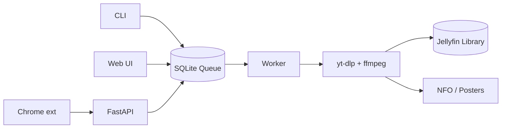

<div align="center">

# 🎬 yt2jellyfin

### YouTube → Jellyfin, one click away

**Download videos, playlists & channels straight into your Jellyfin library** —  
with posters, NFO metadata, subtitles, a resilient job queue, web UI & Chrome extension.

[](https://www.python.org/)
[](https://github.com/yt-dlp/yt-dlp)
[](https://opensource.org/licenses/MIT)
[](https://jellyfin.org/)
[](https://fastapi.tiangolo.com/)

[Features](#-features) · [Quick start](#-quick-start) · [CLI](#%EF%B8%8F-cli) · [Web UI](#-web-ui) · [Chrome extension](#-chrome-extension) · [Config](#-configuration)

</div>

---

## ✨ Features

<table>
<tr>
<td width="50%">

🎯 **Smart downloads**
- Single videos, full playlists & entire channels
- Quality cap (`max_height`) with automatic best-format selection
- Audio + video always merged properly (ffmpeg)

📝 **Jellyfin-ready metadata**
- `.nfo` sidecars Jellyfin understands
- `poster.jpg` / `fanart.jpg` thumbnails
- Subtitles embedded or kept as sidecars

</td>
<td width="50%">

⚡ **Reliable queue**
- SQLite-backed jobs with exponential-backoff retries
- Download archive → re-runs never redo finished videos
- Parallel-safe worker for cron / Task Scheduler

🖥️ **Three ways to use it**
- **CLI** — scriptable & pipe-friendly
- **Web UI** — paste URLs, watch live progress
- **Chrome extension** — send YouTube tabs in one click

</td>
</tr>
</table>

---

## 🚀 Quick start

### 1. Requirements

| | |
|---|---|
| 🐍 Python | **3.10+** |
| 🎞️ ffmpeg | on your `PATH` ([download](https://ffmpeg.org/download.html)) |
| 📁 Library folder | any folder Jellyfin watches |

### 2. Install

```bash
git clone https://github.com/level7up/yt2jellyfin.git
cd yt2jellyfin
pip install -e .
```

### 3. Configure

```bash
yt2jellyfin config init
# then edit config.yaml
```

```yaml
library_path: "D:/media/youtube"   # ← your Jellyfin library folder
```

> Full options: [`config.example.yaml`](config.example.yaml)

### 4. Jellyfin side

1. Create a **Movies** library → point it at `library_path`
2. Refresh after downloads

```
<library>/
├── Video Title [abc123XYZ].mp4
├── Video Title [abc123XYZ].nfo
├── Video Title [abc123XYZ].poster.jpg
└── Another Video [def456UVW].mp4
```

---

## 🖥️ CLI

```bash
# Download & wait
yt2jellyfin download -w "https://www.youtube.com/watch?v=..."

# Playlist or channel
yt2jellyfin download -w "https://www.youtube.com/playlist?list=..."
yt2jellyfin download "https://www.youtube.com/@channelname"

# Custom destination for this run
yt2jellyfin download -o "D:/media/youtube/Kids" "https://youtu.be/..."

# Queue management
yt2jellyfin queue list
yt2jellyfin queue list --status failed
yt2jellyfin queue retry <id>
yt2jellyfin queue clear

# Background worker (cron / Task Scheduler)
yt2jellyfin worker

# Web UI + worker
yt2jellyfin serve          # → http://127.0.0.1:8392

# Probe without downloading
yt2jellyfin info "https://www.youtube.com/watch?v=..."
```

<details>
<summary><code>yt2jellyfin --help</code></summary>

```
usage: yt2jellyfin [-h] [-c CONFIG] [-v] [--version] {download,queue,worker,serve,config,info}

positional arguments:
  {download,queue,worker,serve,config,info}
    download            Queue one or more YouTube URLs
    queue               Inspect / manage the job queue
    worker              Run background worker (queue consumer)
    serve               Start web UI + worker
    config              Config helpers
    info                Probe a URL without downloading
```
</details>

---

## 🌐 Web UI

```bash
yt2jellyfin serve
# open http://127.0.0.1:8392
```

```
┌─────────────────────────────────────────────┐
│  yt2jellyfin     library: D:\media\youtube  │
├─────────────────────────────────────────────┤
│  ➕ paste URL(s) …            [ Queue ]     │
│  📂 destination folder        [ Browse ]    │
├─────────────────────────────────────────────┤
│  ● running   Video Title      ████████░░ 78%│
│  ● done      Another Clip     ✓ 1080p       │
│  ● failed    Restricted vid   ↻ retry       │
└─────────────────────────────────────────────┘
```

- Live job progress & status counts
- Folder picker for destinations
- Retry / remove jobs
- “Open file / Open folder” on completed downloads

---

## 🧩 Chrome extension

Send any YouTube page to the server without leaving the tab.

| | |
|---|---|
| **1** | Start the server: `yt2jellyfin serve` |
| **2** | `chrome://extensions` → enable **Developer mode** |
| **3** | **Load unpacked** → select the [`extension/`](extension/) folder |
| **4** | Open the extension ⚙ → **Test connection** |

**What you get**

- 🟣 **Floating button** on videos, playlists & channels
- 🖱️ **Right-click → “Send to yt2jellyfin”** on any link
- 📊 **Popup** with server status, queue counts & recent jobs
- ⚙️ **Options** — server URL + optional default folder

---

## ⚙️ Configuration

| Key | Default | Description |
|-----|---------|-------------|
| `library_path` | — | Jellyfin library folder |
| `download_archive` | `.yt2jellyfin/archive.txt` | Skip already-downloaded IDs |
| `quality.max_height` | `1080` | Cap video height (`null` = best) |
| `subtitles.enabled` | `true` | Grab auto/manual subs |
| `subtitles.embed` | `true` | Embed via ffmpeg |
| `metadata.nfo` | `true` | Write `.nfo` for Jellyfin |
| `metadata.poster` | `true` | Write `poster.jpg` |
| `download.retries` | `3` | Queue retry attempts |
| `download.concurrent` | `1` | Parallel downloads |
| `web.host` / `web.port` | `127.0.0.1` / `8392` | Web UI bind |

See [`config.example.yaml`](config.example.yaml) for everything.

---

## 🏗️ Architecture



| Module | Role |
|--------|------|
| `yt2jellyfin/config.py` | YAML config discovery + defaults |
| `yt2jellyfin/downloader.py` | yt-dlp wrapper, format selector, validation |
| `yt2jellyfin/metadata.py` | `.nfo`, `poster.jpg`, `fanart.jpg` |
| `yt2jellyfin/queue.py` | SQLite jobs, backoff retries, threaded worker |
| `yt2jellyfin/cli.py` | `download` · `queue` · `worker` · `serve` · `config` · `info` |
| `yt2jellyfin/web.py` + `static/` | REST API + single-page UI |
| `extension/` | Chrome extension (Manifest V3) |

---

## 🛠️ Development

```bash
pip install -e .
python -m yt2jellyfin --help
python -m yt2jellyfin serve
```

Contributions welcome — open an issue or PR at [github.com/level7up/yt2jellyfin](https://github.com/level7up/yt2jellyfin).

---

## ⚠️ Notes

- Only download content you have the right to use — respect YouTube’s [Terms of Service](https://www.youtube.com/t/terms).
- The web UI binds to `127.0.0.1` by default — **do not** expose it publicly without auth.

---

<div align="center">

**Made with 💜 for Jellyfin self-hosters**

[](https://github.com/level7up/yt2jellyfin)

</div>
